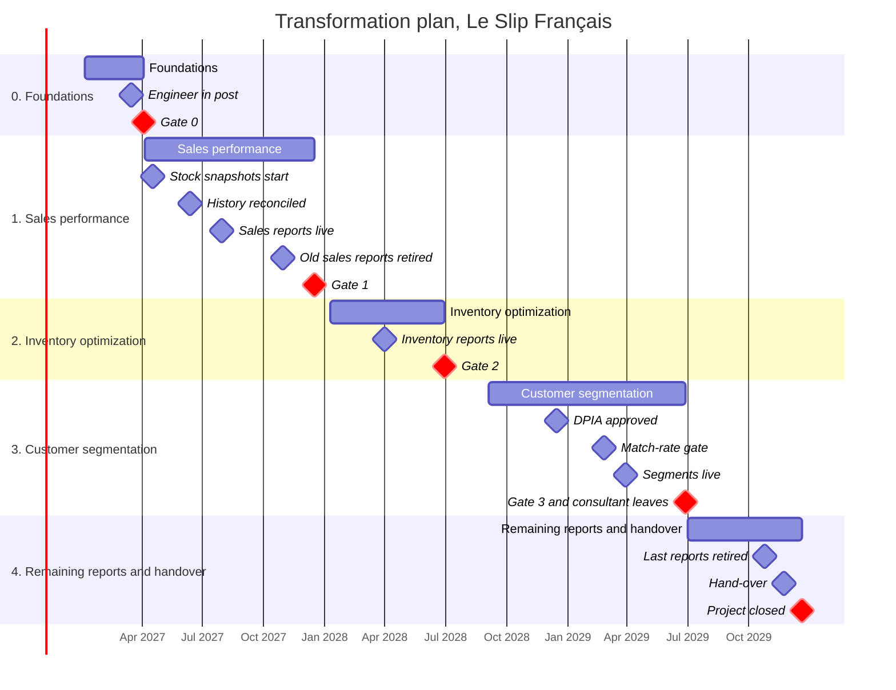

# Part 4: Transformation plan

*Case 6: Urbanization, Datamart / Datalake (multi-channel distribution)*

The brief asks for a **"transformation plan: phasing, migration/deployment, data management strategy (live & legacy), anchoring"**. This part explains how [Le Slip Français](00-company-profile.md) moves from today's silos to the **cloud lakehouse on Microsoft Fabric** chosen in [Part 1](01-architecture-options.md). It uses:

- the **order of the use cases** from Part 1, §9: sales → inventory → segmentation;
- the **consultant days and yearly costs** from [Part 3](03-costing.md), so the plan and the budget describe the same project;
- the **mitigations** promised in the risk register of [Part 2](02-swot-risks.md), each with a date;
- the **governance rules** of [Part 6](06-governance-gdpr.md) (glossary, matching rules, access, retention, erasure).

The dates, phases, milestones and sources are kept in `analysis/plan_phases.csv`, `plan_milestones.csv` and `plan_sources.csv`. `python analysis/plan.py` prints every table and the Gantt chart of this part, and `analysis/test_plan.py` checks that they stay consistent with Parts 2, 3 and 6.

## 1. Our principles

1. **One use case per phase.** Each phase adds the sources it needs and delivers working reports, so value arrives step by step (strength S4 in Part 2). There is no "big bang".
2. **Nothing is switched off before its replacement is proven.** Old reports keep running next to the new ones until the numbers match (§6).
3. **A go/no-go gate at the end of every phase.** The steering committee (general management as sponsor, the CFO, the IT manager and the data owners of Part 6) decides to **go on, adjust or stop**. This is the "fixed scope and a go/no-go gate per use case" of mitigation M-TRF-4.
4. **People and rules before tools.** Four of the five top risks of Part 2 are about people and data, not technology. So the engineer is hired, the glossary is signed and the access rules are approved **before** the first report is built.
5. **The pace of the budget.** Part 3 counts 15 consultant days of setup, 30 days per use case (one use case per year) and 5 days of history loading, with 0.5 of an internal data engineer. The plan follows exactly this pace.

## 2. The plan at a glance

We assume the budget is approved at the end of 2026 and the project starts on **4 January 2027**. Year 1 of the costing is therefore 2027.

| Phase | Use case | From | To | Weeks | Consultant days |
|---|---|---|---|---:|---:|
| 0. Foundations | – | 4 Jan 2027 | 2 Apr 2027 | 13 | 15 |
| 1. Sales performance | sales | 5 Apr 2027 | 17 Dec 2027 | 37 | 35 |
| 2. Inventory optimization | inventory | 10 Jan 2028 | 30 Jun 2028 | 25 | 30 |
| 3. Customer segmentation | segmentation | 4 Sep 2028 | 29 Jun 2029 | 43 | 30 |
| 4. Remaining reports and handover | – | 2 Jul 2029 | 21 Dec 2029 | 25 | 0 |
| **Total** | | | | | **110** |

| Phase | Scope | Team | Go/no-go gate |
|---|---|---|---|
| 0. Foundations | Fabric in an EU region, Fivetran, dbt and git; raw, cleaned and business layers; access by role; glossary, retention rules and erasure procedure approved | Consultant, internal data engineer, IT manager, DPO, CFO | Platform and access tests pass; glossary signed by its owners; the internal data engineer is in post |
| 1. Sales performance | ERP, POS and Shopify loaded; 3 years of history; Sales mart and Power BI sales reports; daily stock snapshots; matching rules; inventory baseline | Consultant, data engineer, sales director (steward), CFO, e-commerce director, CRM manager, supply chain director | Sales reconcile with ERP finance within 0.5 % for two month-end closes; old sales reports retired on their dates |
| 2. Inventory optimization | Inventory mart (stock cover, sell-through, stock-outs, overstock, production) built on the stock snapshots and the sales already loaded | Consultant, data engineer and back-up, supply chain director, production planner, CFO | Supply chain uses the stock reports every week; stock-outs and overstock compared with the baseline |
| 3. Customer segmentation | DPIA; Klaviyo, Zendesk, web analytics and social media loaded; golden customer; Customer and Marketing marts; consent and erasure in every layer | Consultant, data engineer and back-up, marketing director, CRM manager, DPO, customer service manager | Match-rate target reached; segments exclude people without consent; an erasure test passes in every layer |
| 4. Remaining reports and handover | Last channel reports (support, web and social dashboards) moved and retired by the internal team alone; run book completed | Data engineer and back-up, IT manager, data owners, data champions | Every old channel report retired; the run team has worked the whole phase without the consultant |

**Why three years, when one use case only needs 30 consultant days?** The build itself could go faster. The limit is the people: Le Slip Français has 69 employees, and the same managers (CFO, sales, supply chain, marketing) must define rules, test reports and change their habits. One change at a time is what a small company can absorb. It is also what Part 3 assumes: manual work falls a little each year (from 0.6 analysts today to 0.5, 0.4 and 0.3), and inventory benefits are counted in years 2 and 3.

The gaps between phases are planned: the Christmas holidays (end of 2027) and the summer of 2028, when the DPO prepares the impact assessment and the team stabilizes the inventory reports.

**Why is inventory before segmentation?** The work breakdown of the spec suggested segmentation second. Part 1, §9 changed the order after scoring the three use cases: inventory (83/100) comes before segmentation (58/100) because it needs only ERP stock data plus the sales already loaded, contains no personal data, and has the biggest financial impact. Segmentation needs the single customer view and a DPIA, the hardest work, so it comes last. The master data management (MDM) work moves with it: the matching rules are written and tested from phase 1, and the golden customer is built in phase 3, just before the segments.

## 3. What happens in each phase

### Phase 0: Foundations (January to March 2027)

- **The internal data engineer comes first.** Recruitment starts as soon as the budget is approved, so the engineer is in post by mid-March, before the build (M-TRF-3). They work in pairs with the consultant for the whole project, so the knowledge stays in the company.
- **The platform:** a Fabric Warehouse in the West Europe region (EU, for the GDPR), reserved for one year at the smallest capacity, F2. We use the Warehouse because its dbt adapter is supported, and no preview feature goes into production (M-TRF-7). Fivetran, dbt and a git repository are set up.
- **The rules of Part 6 become real:** the glossary is signed by each owner (M-TRF-9), access is given by role, the raw layer is open only to the data engineer, and the DPO approves the retention periods and the erasure procedure.
- **Confirm the ERP** at kick-off (M-TRF-11). We assume Business Central; if it is SAP Business One, Part 1 §7 says to ask for quotes before buying the platform.

### Phase 1: Sales performance (April to December 2027)

- The **ERP, POS and Shopify** are connected, and 3 years of history are loaded (§4).
- **Daily stock snapshots start in April**, as soon as the ERP is connected. An ERP usually keeps only today's stock, and inventory optimization needs history (Part 1, §9). By the start of phase 2 we will have about 9 months of daily stock.
- The **customer matching rules** of Part 6 are approved and the data stewards are named in June (M-TRF-2). The rules are applied at once to the customers we already load (Shopify accounts and store e-receipt emails). A dbt test measures the match rate every month, so the rules are mature when segmentation starts. This is allowed before the DPIA: matching only links the records of the same person for sales reporting, and nobody is scored or targeted. The DPIA is needed for segmentation, which evaluates customers (Part 6, §4).
- The **inventory baseline** (M-TRF-12): from July to December, the supply chain director counts stock-outs and overstock every month from the snapshots. Without this "before" picture, nobody could prove later that the inventory reports helped. This matters because the project only pays back if inventory decisions improve (Part 2, W3).
- The sales reports go live at the end of July, then run next to the old reports until the end of October (§6).

### Phase 2: Inventory optimization (January to June 2028)

- The Fabric capacity stays at F2, as costed in Part 3. The Capacity Metrics app (§7) shows if the inventory reports need the next size, F4.
- The Inventory mart uses the stock snapshots, the production data of the factories, and the sales of all channels already loaded in phase 1. It shows stock cover, sell-through, and the lists of stock-outs and overstock defined in the glossary.
- The inventory reports go live at the end of March. From April, stock-outs and overstock are compared with the baseline **every month**, and the result is reviewed at gate 2 (M-TRF-12).

### Phase 3: Customer segmentation (September 2028 to June 2029)

- **The DPIA comes first** (M-TRF-5). Part 6 showed that segmentation meets two CNIL criteria (evaluation of customers, large scale), so the impact assessment must be approved **before** any customer data is loaded for segmentation. The DPO works on it from September to December 2028.
- **Before loading Klaviyo, choose how** (November 2028, M-TRF-6). Klaviyo's email events make it the biggest Fivetran cost: about 17,000 € in year 3, out of about 18,900 € of Fivetran rows over the 3 years (Part 3, §3). The data engineer checks which event types are really needed (Part 6 only uses opens and clicks) and compares Fivetran with Airbyte, which is free if we host it but must then be maintained.
- In January 2029, **Klaviyo, Zendesk, web analytics and social media** are connected, with the marketing consent flag carried from the source.
- **The match-rate gate** (M-TRF-2): the phase starts with the DPIA and the loading of the customer sources, but the golden customer and the segments are only built when at least 90 % of the Klaviyo profiles with an order are matched to a Shopify customer, and fewer than 200 pairs wait for manual review (Part 6, §2).
- The Customer and Marketing reports go live at the end of March. Segments exclude people without marketing consent. In May, the erasure procedure of Part 6 is tested end to end on a test customer, from the source tools to Power BI.

### Phase 4: Remaining reports and hand-over (July to December 2029)

- **The consultant leaves at gate 3** (end of June 2029), after handing over to the data engineer and the back-up. Phase 4 has no consultant days in Part 3, and this is on purpose: it is the test that the internal team can run the platform alone (§7).
- The internal team moves the last channel reports (support, web and social dashboards) to Power BI and retires them.
- The run book is completed and the steering committee becomes the **data governance committee**. The project closes in December, after a whole phase without the consultant.

### All milestones

| Date | Phase | Milestone | Mitigation |
|---|:-:|---|---|
| 4 Jan 2027 | 0 | Kick-off: ERP confirmed as Business Central (if it is SAP Business One, quotes are asked before the platform is bought) | M-TRF-11 |
| 15 Jan 2027 | 0 | Fixed scope per phase and a 15 % contingency approved by the CFO | M-TRF-4 |
| 29 Jan 2027 | 0 | Fabric Warehouse in West Europe with its supported dbt adapter, no preview features in production | M-TRF-7 |
| 26 Feb 2027 | 0 | Glossary signed by its owners; raw layer open to the data engineer only; retention periods and erasure procedure approved by the DPO | M-TRF-9 |
| 15 Mar 2027 | 0 | Internal data engineer in post (hired or trained) and paired with the consultant for the whole build | M-TRF-3 |
| 19 Mar 2027 | 0 | 1-year Fabric reservation and annual Fivetran contract signed; Airbyte kept as back-up | M-TRF-6 |
| 2 Apr 2027 | 0 | Go/no-go for phase 1 |  |
| 16 Apr 2027 | 1 | Business Central link to Fabric live; the daily stock snapshot starts, because the ERP keeps only today's stock |  |
| 14 May 2027 | 1 | Shopify and POS loaded by Fivetran every 15 minutes; POS in small batches with retries, freshness tests per store and a daily reconciliation with ERP sales totals | M-TRF-8 |
| 11 Jun 2027 | 1 | 3 years of history (2024 to 2026) loaded once, reconciled with ERP finance, then frozen |  |
| 25 Jun 2027 | 1 | Customer matching rules approved and data stewards named; match rate measured by a dbt test and reported every month | M-TRF-2 |
| 1 Jul 2027 | 1 | Inventory baseline starts: stock-outs and overstock counted every month from the snapshots | M-TRF-12 |
| 30 Jul 2027 | 1 | Sales reports live, with the last refresh time on every page; parallel run with the old reports starts | M-TRF-9 |
| 29 Oct 2027 | 1 | Old sales reports retired after two reconciled month-end closes (August and September) |  |
| 30 Nov 2027 | 1 | A second person trained as back-up for the data engineer | M-TRF-3 |
| 17 Dec 2027 | 1 | Six-month inventory baseline (July to December) presented to the steering committee | M-TRF-12 |
| 17 Dec 2027 | 1 | Go/no-go for phase 2 |  |
| 10 Jan 2028 | 2 | Inventory build starts on 9 months of snapshots; Fabric capacity checked with the Capacity Metrics app (it stays at F2 unless the app shows it is too small) |  |
| 31 Mar 2028 | 2 | Stock cover, sell-through, stock-out and overstock lists live; parallel run with the supply chain spreadsheets |  |
| 28 Apr 2028 | 2 | First monthly comparison of stock-outs and overstock with the baseline | M-TRF-12 |
| 30 Jun 2028 | 2 | Go/no-go for phase 3; inventory result reviewed against the baseline | M-TRF-12 |
| 4 Sep 2028 | 3 | DPIA for customer segmentation started by the DPO | M-TRF-5 |
| 17 Nov 2028 | 3 | Klaviyo loading chosen: which event types Fivetran syncs, compared with Airbyte (free if self-hosted), because Klaviyo is the biggest Fivetran cost | M-TRF-6 |
| 15 Dec 2028 | 3 | DPIA approved: customer data can be loaded for segmentation | M-TRF-5 |
| 15 Jan 2029 | 3 | Klaviyo and Zendesk loaded every hour, web analytics and social media every day; consent flag carried from the source | M-TRF-5 |
| 26 Feb 2029 | 3 | Match-rate gate: at least 90 % of Klaviyo profiles with an order matched, and fewer than 200 pairs waiting for review | M-TRF-2 |
| 30 Mar 2029 | 3 | Customer and Marketing reports live; segments exclude people without consent |  |
| 31 May 2029 | 3 | Erasure procedure tested end to end, from the source tools to Power BI | M-TRF-5 |
| 29 Jun 2029 | 3 | Go/no-go for phase 4; inventory result reviewed against the baseline; the consultant leaves after handing over | M-TRF-12 |
| 26 Oct 2029 | 4 | Last channel reports (support, web and social dashboards) retired |  |
| 23 Nov 2029 | 4 | Run book complete; the steering committee becomes the data governance committee |  |
| 21 Dec 2029 | 4 | Project closed after the run team has worked one whole phase without the consultant; inventory result reviewed against the baseline | M-TRF-12 |

## 4. Legacy data: what history we load

**Not much is "migrated".** Today there is no central system to move away from: reports are built in Excel from exports of each tool (Part 3, §2). So the legacy data strategy is about **loading history once** into the new platform:

- **3 years of history (2024 to 2026)** for sales: Shopify orders, store tickets and ERP data (wholesale orders, items, finance). Three years give year-over-year comparisons, which the sales director needs from the first day. Loading and checking the POS and ERP history is the "5 days of history loading" costed in Part 3. For the sources loaded by Fivetran (Shopify here, and the customer sources in phase 3), the history comes with the first full copy of the source, which Fivetran does not charge for (Part 3, §3); checking it is part of each phase's build days.
- **Shopify Plus has been used since October 2023** ([Part 0](00-company-profile.md), source 6), so the 3 years are all in one tool. We do **not** load data from the older e-commerce site.
- **Stores closed in 2024–2025** stay in the history as closed locations, so that past totals stay right.
- **History never goes beyond the retention periods of Part 6**: 3 years for Klaviyo and Zendesk, 25 months for web analytics. A test checks this.
- **Not loaded:** the departments' Excel files (they are copies, not sources, and some contain personal data), and stock history before the snapshots start (the ERP does not keep it).

### How we check the history (reconciliation)

1. **Count the rows** per source and per month, and compare them with an export from the source tool.
2. **Compare net revenue** per month and per channel with the ERP finance figures. The definition of net revenue is the one in the glossary (excluding VAT and shipping, after discounts and returns). We accept a gap of **at most 0.5 %**, and every gap is explained in a reconciliation log (for example, a return booked in a different month). The 0.5 % tolerance is **our own choice**; the CFO, who owns the sales data, can change it.
3. **The CFO signs the log**, and the history is then **frozen**: the raw layer only receives new loads, and corrections come as new rows, never as edits. This way any figure can be traced back.

## 5. Live data: how each source is fed

After the history, each source is loaded **incrementally**: only new or changed rows, at the refresh rate of that source. This answers the brief's problem of "different formats and update frequencies".

| Source | Tool | Loaded by | Refresh | Phase | Live from | History loaded once | Note |
|---|---|---|---|:-:|---|---:|---|
| ERP | Business Central | Business Central link to Fabric | every night | 1 | 16 Apr 2027 | 36 months | Wholesale orders, items, stock, production and finance; plus a daily stock snapshot |
| CRM | Klaviyo | Fivetran | every hour | 3 | 15 Jan 2029 | 36 months | Only profiles and events still inside the 3-year retention period |
| POS | Store tills | Fivetran | every 15 minutes | 1 | 14 May 2027 | 36 months | Small batches with retries; the stores closed in 2024-2025 are kept as closed locations |
| E-commerce | Shopify Plus | Fivetran | every 15 minutes | 1 | 14 May 2027 | 36 months | Shopify Plus since October 2023: the 3 years of history are all in Shopify |
| Web analytics | Google Analytics 4 + Meta Pixel | Fivetran | every day | 3 | 15 Jan 2029 | 25 months | Daily totals only; at most 25 months (retention rule) |
| Social media | Instagram, Facebook, TikTok | Fivetran | every day | 3 | 15 Jan 2029 | none | Daily totals only; no history required |
| Customer support | Zendesk | Fivetran | every hour | 3 | 15 Jan 2029 | 36 months | Ticket text stays in the raw layer |

- **Refresh rates follow the sources.** POS and Shopify every 15 minutes, which is the fastest Fivetran Standard rate (Part 1, §8); the CRM and support every hour; the ERP, web analytics and social media once a day. The brief describes POS as "real-time": 15 minutes is enough for our three use cases, but not for live store replenishment (weakness W4 in Part 2).
- **ERP:** Business Central is not loaded through Fivetran. It uses its own link to Fabric (Part 1, §7). Every night the job also copies the current stock into the **daily stock snapshot** table, with the date.
- **Web analytics and social media** are loaded as daily totals only (Part 6, §3). Web data exists only for visitors who accepted cookies.
- **Six sources use Fivetran**: 2 in years 1–2 (POS and Shopify), then 6 in year 3. This is the number of connections costed in Part 3.
- **Every load is kept in the raw layer as received**, with its load time, so it can be replayed and audited.
- **Freshness checks:** dbt checks how old the newest data of each source is, with a "warn" and an "error" threshold [1]. We set them from the refresh rate: for 15-minute sources, warn after 1 hour and error after 3 hours; for hourly sources, 3 and 6 hours; for daily sources, 26 and 50 hours. Every report shows its last refresh time (M-TRF-9), and the POS has a freshness test per store and a daily reconciliation with the ERP sales totals (M-TRF-8).

### Deployment

Changes go through two Fabric workspaces: **development** and **production**. Every dbt change is a pull request in git, reviewed by a second person (the consultant during the project, then the back-up). `dbt build` runs the models and their tests, and only a green build is deployed to production. A phase is deployed when its gate is passed.

## 6. Running old and new reports side by side

The new reports never replace the old ones overnight. For each phase there is a **parallel run**: users keep their old report and use the new one at the same time.

| Phase | Parallel run | What is retired |
|---|---|---|
| 1. Sales | August to October 2027 | Excel sales reports by channel and store |
| 2. Inventory | April to June 2028 | Supply chain stock spreadsheets |
| 3. Segmentation | April to June 2029 | Marketing spreadsheets built from Klaviyo and Shopify exports |
| 4. Remaining | July to October 2029 | Support, web and social dashboards built by hand |

An old report is **retired only when all four conditions are met**:

1. **A replacement exists.** The list of old reports and the Power BI report that replaces each one is the *report replacement map* of [Part 5](05-change-management.md), §3 (mitigation M-CHG-1); this plan gives the map its dates.
2. **The numbers match** within the tolerance (§4) for **two month-end closes** in a row.
3. **The data owner signs** the retirement (Part 6, RACI).
4. **The users are trained** on the new report (training plan of Part 5).

Then the old file is archived read-only for 3 months and deleted. These 3 months are **our own choice**, not a rule of Part 6: long enough to answer questions about old figures, short enough not to keep Excel copies that may contain personal data. The **built-in dashboards of the tools** (Shopify, Klaviyo, Zendesk, the ERP) are kept: teams use them for daily work, not for cross-channel reporting.

## 7. Anchoring: how the platform stays in place

A platform built by consultants often dies when they leave. In our plan the consultant leaves in June 2029, and the internal team runs phase 4 alone. Here is how the platform stays alive after that.

### Who owns it

- **The data owners and stewards of Part 6** (RACI) keep their roles: the CFO for sales, the supply chain director for inventory, the marketing director for customers and marketing, the DPO for customer identity.
- **The data engineer** (0.5 of a job, as costed in Part 3) runs the pipelines, with a **trained back-up person** since November 2027 (M-TRF-3).
- **The data governance committee** (the former steering committee) meets every quarter. It decides on new reports, changes to the glossary, and the risk register.

### What is checked, and how often

| How often | What | Who |
|---|---|---|
| Every load | dbt tests (unique keys, missing values, links between tables) and freshness checks; an alert email when one fails | Data engineer |
| Every week | Data quality of each domain (test failures, the matching review queue) | Data stewards |
| Every month | Fabric capacity use and cost, with Microsoft's Capacity Metrics app [2]; match rate; stock-outs and overstock vs the baseline | Data engineer, CRM manager, supply chain director |
| Every quarter | Access review per role (Part 6, RBAC); risk register; adoption figures (Part 5) | IT manager, DPO, data governance committee |
| Every year | Retention purge (Part 6); renewal of the Fabric reservation and the Fivetran and Power BI contracts, comparing with Airbyte (M-TRF-6); DPIA review | Data engineer, IT manager, DPO |

**Every change** to the models follows the deployment process of §5 (pull request, review, green dbt build). All the logic stays in documented dbt models, so a new engineer can take over.

Adoption (active users, retired reports, training) is followed in Part 5.

## 8. The risk mitigations in the plan

Part 2 asked the transformation plan to give a concrete action, with a phase and a date, for the top risks:

| Risk | Mitigation | Where in the plan |
|---|---|---|
| R02: customers can't be matched (16) | **M-TRF-2** | Matching rules and stewards in phase 1 (25 Jun 2027); match rate measured monthly; match-rate gate before segments (26 Feb 2029) |
| R03: dependence on one engineer (16) | **M-TRF-3** | Engineer in post before the build (15 Mar 2027), paired with the consultant; back-up trained (30 Nov 2027); the consultant leaves at gate 3 (29 Jun 2029) and the internal team runs phase 4 alone |
| R12: inventory benefit doesn't arrive (16) | **M-TRF-12** | Baseline measured July to December 2027, before phase 2; monthly follow-up from April 2028; reviewed at gates 1, 2, 3 and 4 |
| R05: GDPR (15) | **M-TRF-5** | Raw layer restricted, retention and erasure approved in phase 0; DPIA approved (15 Dec 2028) before customer data is loaded (15 Jan 2029); consent flag carried; erasure tested (31 May 2029); EU region from phase 0 |

The other Part 4 mitigations of the register are also dated in the milestone table: M-TRF-4 (budget and scope), M-TRF-6 (contracts), M-TRF-7 (no preview features), M-TRF-8 (POS loading and daily reconciliation), M-TRF-9 (glossary and refresh times) and M-TRF-11 (confirm the ERP). R01, the top risk (teams keep their reports), is handled by M-CHG-1 in Part 5; this plan gives it its dates (§6). A test checks that every Part 4 mitigation of the register has a dated milestone.

R12 is now as high as R02 and R03 (16): Le Slip Français must recover about 7.2 % of its inventory losses for the project to pay back (Part 3, §4). This is why the baseline and the monthly follow-up start a whole phase before the inventory reports.

## 9. Limits

- **The dates are our own plan**, starting in January 2027. A slower recruitment of the data engineer would move every phase.
- **The consultant days and the capacity size come from Part 3**, where they are our estimates, not quotes. If a vendor quote differs, the dates may move, but the order of the phases and the gates stay the same.
- **The 0.5 % tolerance and the freshness thresholds are our choices.** They should be agreed with the CFO and the data owners in phase 0.
- **Inventory benefits start a little later than Part 3 assumes.** Part 3 counts them over all of years 2 and 3; in this plan the inventory reports go live at the end of March 2028, so year 2 has about 9 months of benefit. The payback in Part 3 is slightly optimistic.
- **Daily stock snapshots on the real platform, weekly in the proof of concept.** Part 0 §4 sizes the synthetic dataset with one snapshot per week to keep it small. The real platform keeps one per day, which is still a small volume.
- **Only 6 Fivetran connections are counted.** Social media may need one connection per platform (Instagram, Facebook, TikTok); at $5 per connection per month (Part 3), this changes almost nothing.

## Sources

Checked on 13 October 2026. All other figures come from Parts 0–3 and 6, with their own sources.

1. dbt documentation, *freshness* (warn_after and error_after thresholds on sources): https://docs.getdbt.com/reference/resource-properties/freshness
2. Microsoft Learn, *What is the Microsoft Fabric Capacity Metrics app?*: https://learn.microsoft.com/en-us/fabric/enterprise/metrics-app
