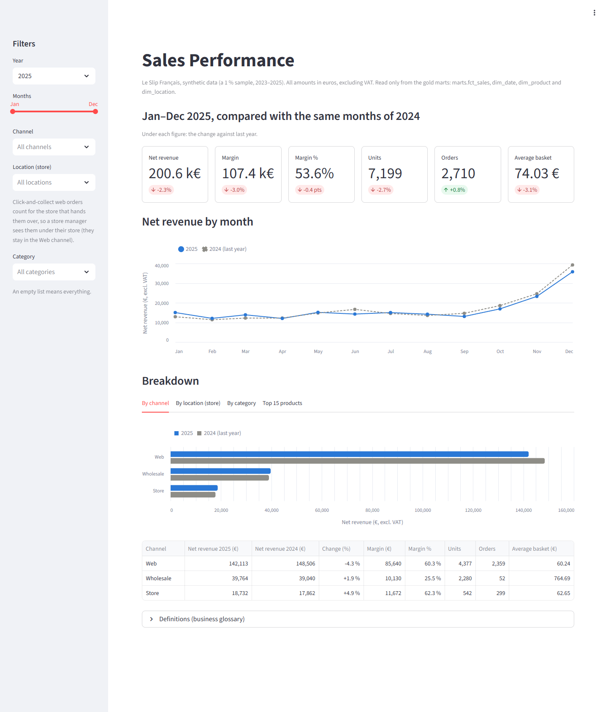

# Proof of concept

A small, local version of the platform chosen in the study: the 7 sources of the brief → a raw layer → cleaned and business tables built with dbt. It runs on a laptop with **synthetic data** and **no cloud account**. DuckDB plays the part of the cloud warehouse (Microsoft Fabric in the study), and a Python script plays the part of Fivetran.

## Run it

You need Python 3.10 to 3.13 (dbt does not support 3.14 yet). From the repository root:

```
py -3.12 poc/run.py          # Windows
python3 poc/run.py           # macOS / Linux
```

That single command:

1. creates a virtual environment in `poc/.venv` and installs `poc/requirements.txt` (first run only, a few minutes);
2. **generates** the synthetic sources into `poc/data/landing/` (`generate.py`);
3. **loads** them, unchanged, into the raw layer of `poc/data/warehouse.duckdb` (`ingest.py`);
4. runs **`dbt source freshness`**: one check per source table, so stale data is flagged before the reports are rebuilt;
5. runs **`dbt build`**: every model and every test;
6. runs **`dbt docs generate`**.

Then `py -3.12 poc/run.py --docs` opens the dbt documentation in the browser, with the **lineage graph** from each source to the report table.

Other options: `--incremental` keeps the warehouse and loads only new or changed files (a changed file replaces the rows it loaded before); `--scale 0.1` makes a smaller dataset for a quick run.

The script always runs inside `poc/.venv` with the pinned versions, even if another dbt is installed on the computer.

## The synthetic sources

A deterministic (fixed seed) **1 % sample** of Le Slip Français's activity over 2023–2025, sized on the public figures of [Part 0](../docs/deliverables/00-company-profile.md) (§4): about 2,400 web orders, 300 store tickets and 52 wholesale orders a year, 8,500 people, 1,500 SKUs. The generated data matches the company profile: an average web basket of about 63 € excluding VAT, about 42 % of web buyers buying again, and a revenue split of about 72 % web, 9 % stores and 19 % wholesale.

Each source keeps the format of its tool, with the problems the platform must solve:

| Source | Tool | Files | Problems on purpose | Refresh (Part 4) |
|---|---|---|---|---|
| E-commerce | Shopify Plus | `shopify/*.jsonl` | prices include VAT; Paris time with its offset; returns refunded weeks later; click-and-collect | every 15 minutes |
| POS | store tills | `pos/<store>/tickets_<day>.csv`, `z_<day>.csv` | one small file per store and day; French formats (`;`, `29,00`, `dd/mm/yyyy`); returns as negative quantities | every 15 minutes |
| ERP | Business Central | `erp/*.csv`, `erp/stock/stock_<monday>.csv` | column names like `No.` and `Posting Date`; stock as a full snapshot each week; revenue as negative accounting credits | every night |
| CRM | Klaviyo | `klaviyo/*.jsonl` | other customer ids; some emails differ from Shopify; nested JSON | every hour |
| Customer support | Zendesk | `zendesk/tickets.jsonl` | UTC times; free text | every hour |
| Web analytics | Google Analytics 4 | `ga4/daily_traffic.csv` | dates as `YYYYMMDD`; daily totals only | every day |
| Social media | Instagram, Facebook, TikTok | `social/*` | three platforms, three formats (JSON lines, one JSON document, CSV with US dates) | every day |

The same person has a different id in each tool, their email is sometimes typed with capitals or spaces, and Klaviyo sometimes has the phone in French format (`06 12 34 56 78`). Some families share one phone, and some people unsubscribed in Klaviyo while Shopify still says "subscribed". The golden customer (below) fixes this.

The wholesale customers are anonymous ("Carrefour hypermarket 01", "Monoprix store 01"): the study does not name the stores. Revenue is booked in account 701 of the French chart of accounts (sales of finished products), since the company makes what it sells.

### Assumptions of the generator

Part 0 gives the volumes, the basket, the share of repeat buyers and the channel split. Everything else is **our assumption**, set as a named constant at the top of `generate.py`:

| Assumption | Value |
|---|---|
| Sales by month | peaks in November (Black Friday) and December (Christmas) |
| Best sellers | each product's popularity is log-normal: the top 20 % of SKUs make about three quarters of the units sold |
| Sales by size | S 10 %, M 30 %, L 30 %, XL 20 %, XXL 10 % |
| Free shipping | from 69 € incl. VAT; 4.90 € below |
| Web orders with a promotion | 2 in 5, at 10 % or 20 % |
| Web orders cancelled / collected in a store / with a return | 2 % / 5 % / 8 % |
| Store tickets in Paris and Toulouse | 60 % / 40 % |
| Store tickets sent by email / store lines that are a return | 60 % / 3 % |
| Production cost | 30 % to 45 % of the price excl. VAT |
| Stock and production | each location reorders from its own sales: when its stock (plus what is on the way) falls to the forecast sales of the lead time, it is brought back to 6 to 16 weeks of sales; 8 % of SKUs get 35 to 60 weeks by mistake. The forecast follows the season of the month. The factory takes 3 weeks and makes what the warehouse orders (the production orders); a store is restocked in 1 week and only keeps the SKUs it sells; the warehouse keeps 1 unit of safety stock |
| Wholesale price | 50 % of the retail price excl. VAT |
| People subscribed to emails / opening a campaign | 35 % / 30 % (the Part 3 assumptions) |
| People with a Klaviyo profile / with another email in Klaviyo | 70 % / 10 % |
| Subscribers who later unsubscribed in Klaviyo only | 10 % |
| People who share a phone with a family member (same last name and address) | 3 % |
| Web conversion rate | 2 % (Part 0) |

Smaller data-quality settings (how many emails are typed with capitals, how many profiles have a phone number) are in the code next to where they are used.

**Privacy.** Every person is fake: names come from short lists and emails use the reserved `example.com`, `example.org` and `example.net` domains. The fields that [Part 6](../docs/deliverables/06-governance-gdpr.md) marks "drop" (IP address, payment card, cashier name, cookie ids) are not generated at all, as if the loading tool's column blocking were on.

## The layers

| Layer | Where | What |
|---|---|---|
| Raw | `raw_<source>` schemas | the files exactly as received (CSV columns as text, JSON records whole), plus `_source`, `_file`, `_batch_id`, `_loaded_at`. `raw_meta.load_log` remembers every file and its content hash, so each file is loaded once. |
| Staging | `staging` schema, `dbt/models/staging` | one model per source table: English names, real types, French formats parsed, Shopify JSON unnested. Emails, phones, names and addresses stay in the raw layer: only a hash of the email and of the phone comes through, for matching. |
| Intermediate | `intermediate` schema | building blocks: one row per till ticket; every order line of the three channels in one shape; the customer records, their matches and the golden customer of each. |
| Marts | `marts` schema | the report tables. |

### Store sales checked against the tills

**`marts.fct_pos_daily_sales`**: the net revenue (after discounts and returns, excluding VAT, as the glossary defines it), tickets and units of each store per day.

Its business test, `dbt/tests/assert_pos_daily_sales_match_z_reports.sql`, checks every store day against the till's end-of-day **Z report**: the same amount paid, to the cent, and the same number of tickets, as a store manager would. The end-to-end test shows that a Z report just one cent off makes `dbt build` fail.

### The Sales Performance mart

The first use case of the study (issue #9), in `dbt/models/marts/sales`:

| Table | Grain | What |
|---|---|---|
| `fct_sales` | one order line | every Web, Store and Wholesale line, with quantity, gross revenue, discount, net revenue and margin, all excluding VAT; plus one row per returned line |
| `dim_date` | one day | year, quarter, month, ISO week, weekday, and the same day last year, for period-over-period and year-over-year comparisons |
| `dim_product` | one SKU | product, category, size, colour, unit price and unit cost from Business Central |
| `dim_location` | one location | the warehouse/factory and the two stores |
| `fct_sales_monthly` | month × channel × location | orders, units, net revenue, margin, average basket, and the net revenue of the previous month and of the same month last year |
| `fct_sales_reconciliation` | month × channel | the mart's net revenue against the revenue finance booked in the ERP general ledger, with the gap |

The rules, from the glossary of [Part 6](../docs/deliverables/06-governance-gdpr.md):

- **Net revenue** excludes VAT and shipping fees and comes after discounts and returns. Each line is converted from the VAT-inclusive Shopify and till prices and rounded to the cent. Cancelled web orders are not orders, so they are left out.
- **Returns** are rows of their own, with negative quantity and amounts, dated **on the day of the refund**. A return lowers the net revenue of the month it happens in, not the month of the sale.
- **Click-and-collect** orders stay in the Web channel (finance books them there), but their **location is the store** that hands them over. A store manager filtering on their store sees their till sales and the web orders collected there (story 4).
- **Margin** is net revenue minus quantity × the unit cost of the ERP.
- **Customer key** is the golden customer of the Shopify customer or of the store ticket's e-receipt email (see the Customer mart). A store ticket without an email has the key `anonymous`, a wholesale order the key `wholesale`, so every row has a key of `dim_customer`.

**Reconciliation with finance (story 5).** `dbt/tests/assert_sales_reconcile_with_erp_finance.sql` compares the mart with the general ledger for every month and channel. The gap must stay within **0.5 %** of the ERP figure: the tolerance of [Part 4](../docs/deliverables/04-transformation-plan.md) (§4), set as `reconciliation_tolerance` in `dbt/dbt_project.yml`. On the generated data the largest gap is a few cents in a month (cent rounding per line). The end-to-end test shows that a month booked 0.6 % higher in the ledger makes `dbt build` fail.

### The Inventory Optimization mart

The third use case (issue #12), in `dbt/models/marts/inventory`. It reuses `dim_date`, `dim_product` and `dim_location` of the sales mart, and takes its demand from `fct_sales`, so stock and sales use the same figures.

| Table | Grain | What |
|---|---|---|
| `fct_stock_snapshot` | snapshot date × location × SKU | stock on hand from the ERP snapshot, demand of the last 28 days, stock cover, sell-through rate, and the stockout, stockout risk, overstock and slow mover flags |
| `fct_production` | one production order | the units of a SKU the factory finished on a day |

The rules, from the glossary of [Part 6](../docs/deliverables/06-governance-gdpr.md):

- **Demand** is the units sold in the **28 days before the snapshot date**, in **all channels**: Web, Store and Wholesale (wholesale orders leave the same warehouse, so they use the same stock). Returns are not taken off: a buyer needs what customers took, and returned items come back into the stock count. Cancelled orders are not sales.
- **Demand is counted where the stock leaves**, the location of `fct_sales`: the warehouse for shipped web orders and wholesale, the store for till sales and click-and-collect. So the warehouse's cover counts the online demand (most of the demand), and a store's cover counts its till sales **plus** the web orders collected there, never its till sales only (story 17). Comparing stock in one place with sales of the whole network would hide which location runs out.
- **Stock cover** = stock on hand ÷ (demand ÷ 28), in days. It is empty when nothing sold in 28 days: the cover is endless.
- **Sell-through rate** = units sold ÷ (stock at the start + units received) over the 28 days. Everything that was there or came in was either sold or is still on hand, so this is units sold ÷ (units sold + stock on hand). It needs no stock movements, which the ERP export does not give.
- **Stockout**: zero stock while at least one unit sold. **Stockout risk**: stock left, but less than **14 days** of cover. **Overstock**: more than **180 days** of cover.
- **Slow mover**: stock left that sold nothing in 28 days, so its cover cannot be computed. It is a flag of its own, not an overstock: in a 1 % sample most SKUs sell less than once a month, and counting them all as overstock would hide the SKUs that really have too much stock.

The 28, 180 and 14 days are `demand_window_days`, `overstock_cover_days` and `stockout_risk_cover_days` in `dbt/dbt_project.yml`. 28 and 180 come from the glossary; 14 days is our assumption (two weeks for the factory or the warehouse to send more), to be agreed with the supply chain director. The supply planner's list (story 18) is the latest snapshot filtered on the flags.

On the generated data, the stock follows the sales (see the assumptions of the generator). At the last snapshot, the warehouse holds 1,122 SKUs: 26 are out of stock, 20 at risk, 22 overstocked, and 775 are slow movers, because a 1 % sample of the sales leaves most SKUs with less than one sale a month. The end-to-end tests also set up each case in the stock files, so each test knows its exact case.

Every source declares its refresh schedule and freshness thresholds in `dbt/models/staging/_sources.yml`, set from Part 4 §5: sources refreshed every 15 minutes warn after 1 hour, hourly sources after 3 hours, daily sources after 26 hours.

### The Customer mart

The second use case (issue #11), in `dbt/models/marts/customer`, with the support tickets in `dbt/models/marts/support`. It follows the matching rules of [Part 6](../docs/deliverables/06-governance-gdpr.md) (§2, `governance/mdm_rules.csv`).

**Golden customer.** The records of a person in the tools (Shopify customers, Klaviyo profiles, store tickets with an e-receipt email, Zendesk tickets) are joined when:

1. they have the **same email**, in lower case without spaces;
2. they have the **same phone** in +33 format **and the same first name**;
3. one stores the other's id (a Klaviyo profile synced from Shopify).

Records joined directly or through other records are one golden customer. Its customer key is a hash; issue #14 will add a secret salt in the one macro every key goes through (`dbt/macros/identity.sql`). Matching only ever sees **hashes** of the emails and phones: they stay in the raw layer. `intermediate.int_customers__matches` keeps one row per pair and rule, so a data steward can see why two records were merged (story 26). Rule 4 of Part 6 (same name and postcode) is never automatic and is not in the PoC.

The phone rule asks for the first name too: **a family sharing one phone is not merged**. Part 6 said "same phone" only, but a wrong merge is worse than a missed one, so Part 6 was updated. The spec mentions a loyalty id: Le Slip Français has no loyalty card, and rule 3 (source id link) plays that part.

| Table | Grain | What |
|---|---|---|
| `dim_customer` | one golden customer | first and last order, order count, repeat customer, omnichannel (bought online and in store), recency / frequency / monetary scores, RFM segment, marketing consent, age band, region; plus the two members `anonymous` and `wholesale` |
| `marketing_segments` | one golden customer | the customers marketing may target, with their segment: **only with marketing consent** |
| `fct_ticket` | one Zendesk ticket | date, category, channel, status and satisfaction, with the requester's customer key, to see their orders (story 14) |

**Values that survive the merge.** Region: department of the most recent web shipping address, else of the Shopify customer, else of Klaviyo. Age band: from the Klaviyo birthday. **Marketing consent: given in Shopify or Klaviyo, and withdrawn in neither**: an unsubscribe in any tool wins. The CNIL "existing customer" exception is not used, because the tools do not record whether the customer was told and could refuse.

**RFM segments** (orders of the last 24 months, as of the last day of sales). Recency score: last order 30 days ago or less 5, 90 days 4, 180 days 3, a year 2, older 1. Frequency score: orders in 24 months, 5 for five or more. The segment is the first rule that matches:

| Segment | Rule |
|---|---|
| Lost | no order in 24 months |
| Champions | recency 4-5 and 3 orders or more |
| Loyal | 3 orders or more |
| New | recency 4-5 and 1 order |
| Promising | recency 3-5 and 2 orders |
| At risk | recency 1-2 and 2 orders or more |
| Hibernating | recency 1-2 and 1 order |
| Needs attention | the rest (recency 3, 1 order) |

The 24 months come from the glossary; the recency days (30, 90, 180, 365) and the segment rules are our assumption. Both are `rfm_window_months` and `rfm_recency_days` in `dbt/dbt_project.yml`. The monetary score (net revenue of 24 months, five groups of the same size) is in `dim_customer` for the marketers but does not change the segment. Before segmentation goes live, Part 6 asks for a DPIA (§4).

**On the generated data**, 11,482 records become 7,561 golden customers; 4,474 of them are in the sales or support. 42 % of the customers with an order bought more than once, as in Part 0, and 239 bought both online and in store. 1,359 customers are in the marketing segments. 96 % of the Klaviyo profiles of people who ordered online are matched to their Shopify customer, above the 90 % gate of Part 6. Every sales row has a key: 471 k€ of net revenue from golden customers, 23 k€ from anonymous store tickets and 121 k€ wholesale.

## Dashboard

The demo of the Sales Performance use case (issue #10): a small web page on the sales mart, made with [Streamlit](https://streamlit.io) because the PoC has no Power BI licence. After a first run of `run.py`:

```
py -3.12 poc/run.py --dashboard     # Windows
python3 poc/run.py --dashboard      # macOS / Linux
```

It opens `http://localhost:8501` in the browser. Stop it with Ctrl+C. It reads the warehouse of the last run, so after a new run just reload the page.



What it shows, with the words of the glossary:

- **Filters**: year, months, channel, location (store) and category. An empty list means everything.
- **Six figures**: net revenue, margin, margin %, units, orders and average basket, each with its change against the **same months of last year**, with the same filters.
- **Net revenue by month**, this year and last year on the same chart.
- **Breakdown** by channel, by location (store), by category and for the top 15 products: net revenue this year and last year, change, margin, margin %, units, orders and average basket.

For store managers: click-and-collect web orders count for the store that hands them over (they stay in the Web channel), so filtering on a store shows its till sales and the web orders collected there.

**It reads only the gold marts.** Every query is in `dashboard/sales.py` and goes through one function, `read()`, which checks the query with DuckDB's own SQL parser and refuses any table outside the `marts` schema (and any file read directly). The page itself (`dashboard/app.py`) runs no SQL. The warehouse is opened **read-only**, and only while the page is drawn.

## Tests

After a first run of `run.py`, with the PoC environment:

```
poc/.venv/Scripts/python -m unittest discover poc/tests       # Windows
poc/.venv/bin/python -m unittest discover poc/tests           # macOS / Linux
```

(Any Python runs the generator tests; the others are skipped without dbt and DuckDB.)

- `test_generate.py`: same seed gives the same files, volumes match Part 0, the data looks like the company (best sellers make most of the sales; stock follows the sales of each location and the factory makes about what the warehouse ships), and each source has its quirks.
- `test_ingest.py`: every record is loaded unchanged with its metadata, a second run loads only new files, a changed file replaces its old rows, and paths with an apostrophe work.
- `test_pipeline.py`: `dbt build` is green, the store sales match the tills, a Z report one cent off is caught, all 19 freshness checks pass, and a late source is flagged against its own schedule (2 hours late is a warning for the tills but fine for the ERP; 4 days late is an error for web analytics).
  For the sales mart, against the generated source files: the net revenue of the mart is the store plus web net sales of the files; it reconciles with the ERP ledger, and a ledger month 0.6 % off is caught; every click-and-collect order is credited to its store; every return is on its refund day and lowers net revenue; the monthly table carries the right previous month and last year; and the mart has every column planned in `governance/marts.csv`.
- `test_customer_mart.py`: the customer mart, against the source files, with a household and a person under a second email added to them. Records sharing an email typed in another case or with spaces are one golden customer, in the sales and in support; a family sharing one phone is not merged; the same phone and first name are merged, and an unsubscribe in Klaviyo then removes the customer from the segments; customers who never consented or withdrew are not in the marketing segments; every sales row has a golden customer or the `anonymous` or `wholesale` member; omnichannel customers bought both online and in store; RFM segments follow the rules above; no email or phone reaches any mart; and `dim_customer` has every column planned in `governance/marts.csv`.
- `test_inventory_mart.py`: the inventory mart, against the source files, with a few stock levels changed in the ERP files to set up each case. A SKU with zero stock that sold is a stockout; a store's cover counts the web orders collected there, not only its till sales, and the warehouse's demand is the web and wholesale units it ships; a cover just above 180 days is overstock and one at or below it is not; stock that sold nothing is a slow mover, not an overstock; on every row, stock, demand, cover, sell-through and the four flags follow the glossary; production matches the ERP production orders; and the mart has every column planned in `governance/marts.csv`.
- `test_dashboard.py`: the dashboard refuses raw, staging and intermediate tables and files, every query it sends reads only `marts` tables, the page runs no SQL of its own, and the warehouse is read-only. On a small generated warehouse, its figures match the mart: the totals and last year match `fct_sales_monthly`; a store, a category and some months match `fct_sales` this year and last year (net revenue, orders, average basket); a store sees the click-and-collect orders it hands over; channels and locations add up to the total; and the page opens without error, also with a store filter.

The same seed gives the same data with the same Python version; Python only promises the same random numbers within a version.

## Differences with the real platform

- **DuckDB instead of Fabric.** The SQL is standard; moving it to Fabric Warehouse (or BigQuery, Snowflake) means changing the dbt adapter and a few date functions.
- **Files instead of Fivetran and the Business Central link.** `ingest.py` does what the ELT tools would do: load without changing, add load metadata, load only what is new.
- **Stock once a week**, to keep the dataset small. The real platform keeps one snapshot per day (Part 4).
- **No real-time.** As in the study, POS data arrives in small batches.
